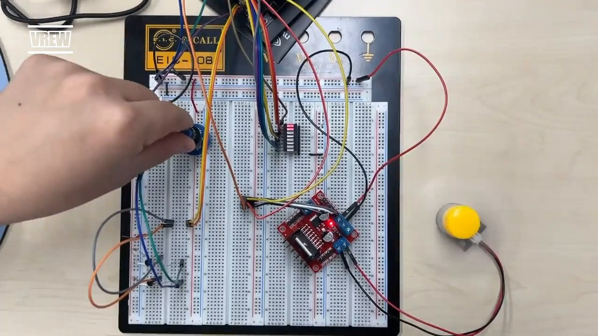
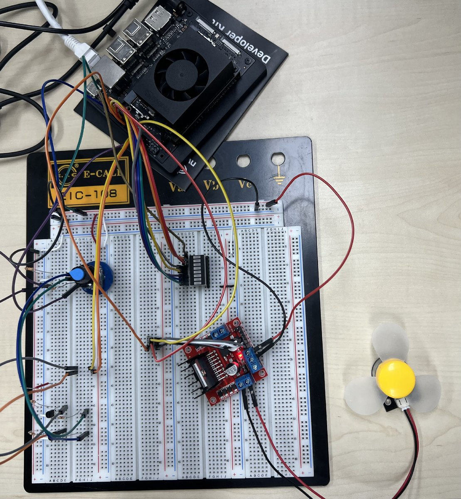
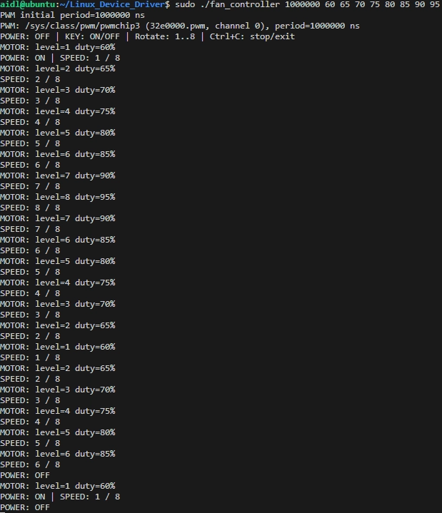
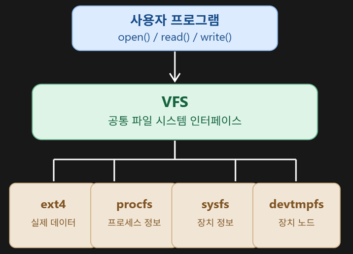
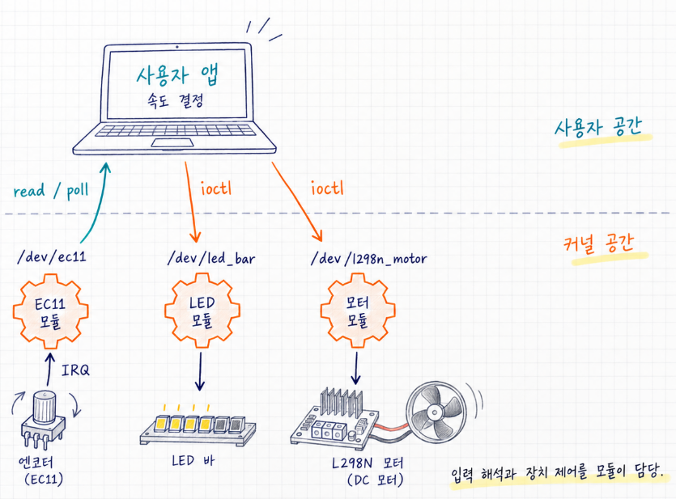
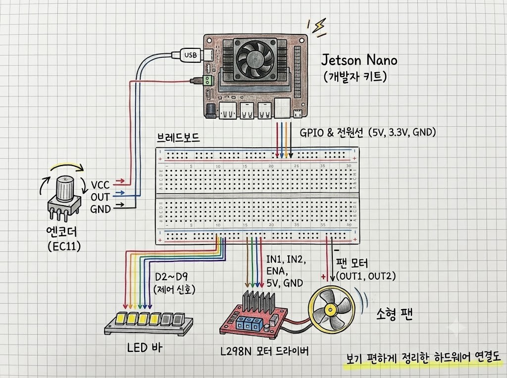

# NVIDIA Jetson Orin Nano Embedded Linux Device Driver Project

<div align="center">

-blue?logo=linux)


-orange?logo=c)


<br/>

**NVIDIA Jetson Orin Nano 환경에서 "유저 공간 직접 제어(User-Space Direct Control)"와  
"커널 캐릭터 디바이스 드라이버(Kernel Character Device Driver)"를 모두 구현하고 심층 비교·분석한 임베디드 리눅스 프로젝트입니다.**

<br/>

| 팀원 | 역할 및 기여 |
|:---:|:---|
| **김경태** | 유저 공간 제어 구현 (`libgpiod`, sysfs PWM 기반 `fan_controller`), 엔코더 FSM 프로토타입 설계 및 환경 구성 |
| **박상현** | EC11 엔코더 커널 드라이버 구현, 쿼드러처 FSM 디텐트 탈출 언래치 알고리즘 개발, 채터링 차단 및 코드 리팩토링 |
| **석민정** | WCNLB8-SR12 8-Bar LED 커널 드라이버 구현, GPIO 매핑 및 비트마스크 레벨 미터 제어, 문서화 지원 |
| **조성수** | L298N DC 모터 커널 드라이버 구현, 커널 PWM/GPIO 서브시스템 연동, 공통 IOCTL 헤더 정의 및 통합 제어 데몬 구현 |

<br/>


<br/>
<em>▲ EC11 엔코더 회전 및 클릭을 통해 DC 모터 PWM 속도 제어와 8-Bar LED 레벨 미터가 실시간 연동되는 하드웨어 구동 모습</em>

</div>

---

## 📑 목차 (Table of Contents)

1. [프로젝트 개요 및 기획 배경](#1-프로젝트-개요-및-기획-배경)
2. [두 가지 구현 방식 심층 비교 (유저 공간 vs 커널 드라이버)](#2-두-가지-구현-방식-심층-비교-유저-공간-vs-커널-드라이버)
3. [시스템 아키텍처 및 VFS 추상화 계층](#3-시스템-아키텍처-및-vfs-추상화-계층)
4. [하드웨어 구성 및 핀 매핑 가이드](#4-하드웨어-구성-및-핀-매핑-가이드)
5. [Jetson-IO 40핀 헤더 Muxing 설정](#5-jetson-io-40핀-헤더-muxing-설정)
6. [커널 디바이스 드라이버 상세 구현 및 기술적 문제 해결](#6-커널-디바이스-드라이버-상세-구현-및-기술적-문제-해결)
   - [6.1 EC11 로터리 엔코더 드라이버 (ec11_driver.ko)](#61-ec11-로터리-엔코더-드라이버-ec11_driverko)
   - [6.2 L298N DC 모터 드라이버 (l298n_driver.ko)](#62-l298n-dc-모터-드라이버-l298n_driverko)
   - [6.3 WCNLB8-SR12 8-Bar LED 드라이버 (led_bar_driver.ko)](#63-wcnlb8-sr12-8-bar-led-드라이버-led_bar_driverko)
   - [6.4 공통 IOCTL 프로토콜 인터페이스 (include/common_ioctl.h)](#64-공통-ioctl-프로토콜-인터페이스-includecommon_ioctlh)
7. [유저 공간 통합 제어 데몬 (app/motor_daemon)](#7-유저-공간-통합-제어-데몬-appmotor_daemon)
8. [빌드, 적재 및 단위 테스트 가이드](#8-빌드-적재-및-단위-테스트-가이드)
9. [핵심 인사이트 및 배운 점 (Key Learnings)](#9-핵심-인사이트-및-배운-점-key-learnings)
10. [디렉터리 구조 및 브랜치 안내](#10-디렉터리-구조-및-브랜치-안내)

---

## 1. 프로젝트 개요 및 기획 배경

본 프로젝트는 **NVIDIA Jetson Orin Nano (ARM Cortex-A78AE, Ubuntu 22.04 LTS, Kernel 5.15-tegra)** 기반에서 로터리 엔코더(EC11)의 입력을 받아 DC 모터(L298N)의 PWM 속도 및 방향을 제어하고, 8-Bar LED 어레이로 현재 속도 단계를 실시간 시각화하는 임베디드 제어 시스템입니다.

### 🎯 핵심 문제의식: "왜 리눅스 디바이스 드라이버를 직접 작성해야 하는가?"
임베디드 리눅스 환경에서는 `libgpiod`나 `/sys/class/...` (sysfs) 가상 파일 시스템을 활용하면 커널을 건드리지 않고도 유저 공간 프로그램만으로 하드웨어를 제어할 수 있습니다.  
본 프로젝트에서는 이러한 의문에 답하기 위해 **동일한 하드웨어 제어 로직을 두 가지 방식(유저 공간 직접 제어 vs 전용 커널 캐릭터 디바이스 드라이버)으로 모두 구현하여 비교·분석**했습니다.

<div align="center">
  
  <br/>
  <em>▲ Jetson Orin Nano Developer Kit, 브레드보드, EC11 엔코더, L298N 모터 드라이버 및 DC 팬, 8-Bar LED 실물 구성</em>
</div>

### 🛠️ 하드웨어 구성 요소
1. **Target Board**: NVIDIA Jetson Orin Nano Developer Kit (JetPack 5.1 / 6.0, Linux Kernel 5.15.199-tegra)
2. **Input Sensor**: **EC11 로터리 엔코더** (A/B 쿼드러처 펄스 신호 + KEY 푸시 스위치)
3. **Actuator**: **L298N (HW-095) Dual H-Bridge 모터 드라이버** + 소형 DC 모터 팬
4. **Indicator**: **WCNLB8-SR12 8-Bar LED 어레이** (속도 단계 레벨 미터 및 점멸 피드백)
5. **Power**: 독립 외부 DC 파워 서플라이 (모터 구동 전원 7.4V~12V) + 공통 접지(Common GND)

---

## 2. 두 가지 구현 방식 심층 비교 (유저 공간 vs 커널 드라이버)

본 프로젝트는 두 가지 아키텍처를 직접 설계하고 동작을 검증함으로써, 리눅스 커널과 유저 공간 사이의 역할 분담 및 성능/안전성 트레이드오프를 체득했습니다.

| 비교 항목 | 방법 1: 유저 공간 직접 제어 (User-Space) | 방법 2: 커널 디바이스 드라이버 (Kernel-Space) |
|:---|:---|:---|
| **작성한 코드** | 단일 유저 공간 제어 프로그램 (`fan_controller`) | 3개의 독립 커널 모듈 (`.ko`) + 경량 이벤트 데몬 (`motor_daemon`) |
| **하드웨어 접근 경로** | `libgpiod` (`/dev/gpiochip0`) + sysfs (`/sys/class/pwm/...`) | 커널 내부 GPIO API + 하드웨어 IRQ + 커널 PWM 서브시스템 API |
| **엔코더 신호 해석 위치** | 유저 프로그램 루프 내에서 폴링 및 엣지 수신 | **커널 하드웨어 인터럽트 핸들러(Top-half ISR)** 내부 FSM |
| **이벤트 처리 모델** | 유저 공간 폴링 및 타이머 기반 디바운스 | 커널 원형 큐 + `wait_queue` + `poll()`/`epoll()` 비동기 통지 |
| **어플리케이션 인터페이스** | 전용 라이브러리 함수 호출 및 sysfs 텍스트 파일 쓰기 | **표준 POSIX VFS 장치 파일 (`/dev/ec11`, `/dev/l298n_motor`, `/dev/led_bar`)** |
| **오류 발생 시 영향 범위** | 프로세스 크래시 시 해당 프로그램만 비정상 종료 (안전 격리) | 버그 발생 시 커널 패닉(Kernel Panic) 유발 가능 (엄격한 자원 관리 필수) |
| **다중 프로세스 재사용성** | 하드웨어 제어 로직을 각 프로그램마다 매번 재구현해야 함 | **표준 `/dev` 노드를 통해 어떤 언어/프로세스에서도 즉시 재사용 가능** |
| **CPU 점유율 및 지연 시간** | sysfs 파일 I/O 및 컨텍스트 스위칭 오버헤드로 고속 회전 시 지연 | **Zero-Polling (0% idle CPU)** 및 마이크로초 단위 즉각 반응 |

<br/>

### 2.1 방법 1: 유저 공간 직접 제어 구현 방식의 특징 및 한계
- **GPIO 제어**: 리눅스 공식 라이브러리인 `libgpiod`를 사용하여 `/dev/gpiochip0` 라인을 요청하고 값을 읽고 씀.
- **PWM 제어**: 커널 PWM 드라이버가 노출한 sysfs 경로(`/sys/class/pwm/pwmchip3/export`, `period`, `duty_cycle`, `enable`)에 파일 I/O를 수행.
- **엔코더 해석**: 프로그램 루프에서 엣지 이벤트를 읽어 상태표를 거쳐 계산. 푸시 버튼은 30ms 유지 여부를 확인하는 소프트웨어 폴링 방식 적용.
- **한계점 관찰**:
  - 엔코더 노브를 고속으로 회전시킬 때 유저 공간 컨텍스트 스위칭 지연으로 인해 펄스 누락 발생.
  - 모터 속도 변경 시마다 sysfs 파일을 열고 닫거나 문자열을 파싱하는 파일 I/O 오버헤드 존재.
  - 다른 프로그램에서 모터나 엔코더를 쓰려면 하드웨어 제어 코드를 다시 작성해야 함.

<div align="center">
  
  <br/>
  <em>▲ 유저 공간 fan_controller 실행 터미널 로그: sysfs PWM 파일 쓰기 및 libgpiod 이벤트 기반 구동</em>
</div>

<br/>

### 2.2 방법 2: 커널 캐릭터 디바이스 드라이버 방식의 가치
- 하드웨어 엣지 인터럽트(IRQ)를 커널 단에서 직접 캡처하여 **단 1개의 펄스 손실도 없는 완벽한 쿼드러처 디코딩** 실현.
- 장치를 `/dev` 아래의 표준 캐릭터 디바이스로 추상화하여, 유저 공간 프로그램은 오직 `read`, `write`, `ioctl`, `poll` 표준 시스템 콜만 호출하면 됨.
- 유저 데몬은 이벤트가 없을 때 커널의 `wait_event_interruptible`에 의해 CPU를 전혀 소모하지 않고 수면(Sleep) 상태를 유지 (Zero-Polling).

---

## 3. 시스템 아키텍처 및 VFS 추상화 계층

리눅스의 핵심 철학인 **"Everything is a file(모든 것은 파일이다)"**과 **가상 파일 시스템(VFS)** 계층을 바탕으로 구축된 전체 시스템 구조입니다.

<div align="center">
  
  <br/>
  <em>▲ 유저 프로그램의 표준 시스템 콜이 VFS를 거쳐 캐릭터 디바이스 노드(/dev)와 파일 시스템으로 연결되는 계층</em>
</div>

<br/>

### 3.1 소프트웨어 & 커널 아키텍처 다이어그램

<div align="center">
  
  <br/>
  <em>▲ 유저 공간 제어 데몬과 3개 커널 모듈, 하드웨어 계층 간의 상호작용</em>
</div>

```
┌────────────────────────────────────────────────────────────────────────┐
│                        [ 유저 공간 (User Space) ]                      │
│                                                                        │
│   app/motor_daemon (단일 비동기 I/O 이벤트 루프)                        │
│   - poll() 기반 /dev/ec11 이벤트 대기 (Zero CPU Idle overhead)         │
│   - 배치 큐 드레인 (Queue Batch Draining) -> 최종 상태 1회 갱신        │
│   - 350ms 스위치 진동 쿨다운 필터링 및 방향 전환 피드백 처리          │
│   - ANSI 터미널 대시보드 렌더링 & SIGINT/SIGTERM Graceful Cleanup      │
└──────────────┬─────────────────────────┬─────────────────────────┬─────┘
               │ read() / poll()         │ ioctl() / write()       │ ioctl() / write()
               ▼                         ▼                         ▼
┌───────────────────────────┬─────────────────────────┬──────────────────────────┐
│  /dev/ec11 (CharDev)      │ /dev/l298n_motor        │ /dev/led_bar             │
├───────────────────────────┼─────────────────────────┼──────────────────────────┤
│ drivers/encoder/          │ drivers/motor/          │ drivers/led_bar/         │
│ ec11_driver.ko            │ l298n_driver.ko         │ led_bar_driver.ko        │
│                           │                         │                          │
│ • 하드웨어 양방향 Edge IRQ│ • Tegra 커널 PWM API    │ • 8-Line Tegra GPIO 제어 │
│ • 16-상태 쿼드러처 FSM    │   (Pin 32, pwmchip3)    │ • 0~8단계 바그래프 미터  │
│ • 디텐트 탈출 언래치 알고리즘│ • H-Bridge GPIO 방향제어│ • 8비트 RAW 비트마스크   │
│ • 원형 큐 (64 슬롯)       │ • 저속 토크 보장 듀티표 │ • 방향전환 순간 점멸     │
│ • wait_queue & spinlock   │ • string & ioctl 지원   │ • ioctl & write 지원     │
└──────────────┬────────────┴────────────┬────────────┴────────────┬─────────────┘
               │                         │                         │
═══════════════╪═════════════════════════╪═════════════════════════╪══════════════
               ▼                         ▼                         ▼
┌───────────────────────────┬─────────────────────────┬──────────────────────────┐
│ EC11 로터리 엔코더        │ L298N DC 모터 드라이버  │ WCNLB8-SR12 8-Bar LED    │
│ (Pin 11, Pin 13, Pin 15)  │ (Pin 32 PWM, Pin 29/31) │ (8개 전용 GPIO 핀)       │
│                           │                         │                          │
│     [회전 입력 & 클릭]    │     [속도 및 회전 제어] │     [속도 레벨 시각화]   │
└───────────────────────────┴─────────────────────────┴──────────────────────────┘
```

---

## 4. 하드웨어 구성 및 핀 매핑 가이드

<div align="center">
  
  <br/>
  <em>▲ Jetson Orin Nano 40핀 확장 헤더와 브레드보드, 센서 및 액추에이터 간의 하드웨어 결선도</em>
</div>

<br/>

### 4.1 통합 하드웨어 핀 맵 테이블 (40-Pin Header 기준)

| 장치 모듈 | 모듈 핀명 | Jetson 물리 핀 | Tegra GPIO 포트 | Line Offset | 신호 기능 및 설명 |
|:---|:---:|:---:|:---:|:---:|:---|
| **EC11 엔코더** | **VCC** | **Pin 1** | 3.3V Power | - | **절대 주의: Pin 1(3.3V) 연결 (5V 인가 금지)** |
| | **GND** | **Pin 6** | GND | - | 공통 접지 (풀업 기준점) |
| | **S1 (CLK)** | **Pin 11** | PR.04 | 112 | 회전 펄스 채널 A (양방향 에지 IRQ) |
| | **S2 (DT)** | **Pin 13** | PY.00 | 122 | 회전 펄스 채널 B (양방향 에지 IRQ) |
| | **KEY (SW)** | **Pin 15** | PN.01 | 85 | 푸시 스위치 버튼 (하강 에지 IRQ) |
| **L298N 모터** | **ENA** | **Pin 32** | PG.06 | 41 | 하드웨어 PWM 속도 제어 (`pwmchip3`, 점퍼캡 제거 필수) |
| | **IN1** | **Pin 29** | PQ.05 | 105 | 모터 방향 제어 GPIO 출력 1 |
| | **IN2** | **Pin 31** | PQ.06 | 106 | 모터 방향 제어 GPIO 출력 2 |
| | **+12V 단자** | **외부 전원 (+)**| - | - | **외부 배터리/SMPS (7.4V~12V) 연결 필수** |
| | **GND 단자** | **외부(-) & Pin 9**| GND | - | **외부 전원 (-)극과 Jetson GND를 묶는 Common GND 필수** |
| **8-Bar LED** | **Bar 1** | **Pin 16** | PY.04 | 126 | 레벨 1단계 (최저속) |
| | **Bar 2** | **Pin 18** | PY.03 | 125 | 레벨 2단계 |
| | **Bar 3** | **Pin 22** | PY.01 | 123 | 레벨 3단계 |
| | **Bar 4** | **Pin 36** | PR.05 | 113 | 레벨 4단계 |
| | **Bar 5** | **Pin 37** | PY.02 | 124 | 레벨 5단계 |
| | **Bar 6** | **Pin 38** | PI.01 | 52 | 레벨 6단계 |
| | **Bar 7** | **Pin 40** | PI.00 | 51 | 레벨 7단계 |
| | **Bar 8** | **Pin 24** | PZ.06 | 136 | 레벨 8단계 (최고속) |
| | **GND** | **Pin 14** | GND | - | 공통 캐소드 접지 (330Ω 저항 권장) |

<br/>

> [!CAUTION]
> ### ⚠️ 하드웨어 결선 시 3대 필수 안전 수칙
> 1. **3.3V 로직 레벨 준수 (Non-5V Tolerant)**:  
>    Jetson Orin Nano의 모든 40핀 헤더 GPIO는 3.3V 전압만 견딥니다. EC11 모듈에 '5V'라고 표기되어 있더라도 **반드시 Jetson Pin 1(3.3V)에 연결**해야 합니다. 5V를 인가하면 SoC 내부 버퍼가 영구 파손됩니다.
> 2. **공통 접지 (Common GND) 필수 연결**:  
>    L298N 나사 단자대의 `GND`에는 **외부 전원 (-)극과 Jetson Pin 9(GND)를 반드시 함께 결선**해야 합니다. 공통 접지가 형성되지 않으면 로직 전위 기준점이 흔들려 모터가 오작동하거나 멈추지 않습니다.
> 3. **모터 서지 전원 분리**:  
>    모터 회전 시 발생하는 역기전력(Back-EMF)과 순간 서지 전류가 Jetson 전원선으로 역류하여 보드가 리셋되는 현상을 막기 위해, L298N 전원은 Jetson 내부 5V가 아닌 **완전 독립된 외부 전원(7.4V~12V)**을 공급해야 합니다.

---

## 5. Jetson-IO 40핀 헤더 Muxing 설정

Jetson Orin Nano의 40핀 헤더 기본 핀맵은 SPI, I2S 등으로 할당되어 있습니다. 일반 GPIO 및 하드웨어 PWM을 사용하기 위해 `jetson-io.py` 도구를 통해 핀 mux 기능을 활성화해야 합니다.

```bash
sudo /opt/nvidia/jetson-io/jetson-io.py
```

### 📋 설정 절차
1. **`Configure Jetson 40pin Header`** 선택 -> Enter
2. **`Configure header pins manually`** 선택 -> Enter
3. 스페이스바(Space)를 눌러 다음 항목들을 활성화합니다:

| 설정 항목 (핀 번호) | 설정할 기능 | 연결 대상 |
|:---|:---:|:---|
| `extperiph3_clk (29)` | `[*] gpio` | L298N IN1 |
| `extperiph4_clk (31)` | `[*] gpio` | L298N IN2 |
| `pwm7 (32)` | `[*] pwm7` | L298N ENA (하드웨어 PWM) |
| `uarta-cts/rts (11,36)` | `[*] gpio` | EC11 S1 (11), LED Bar 4 (36) |
| `spi3 (13,16,18,22,37)` | `[*] gpio` | EC11 S2 (13), LED Bar 1, 2, 3, 5 |
| `pwm1 (15)` | `[*] gpio` | EC11 KEY (15) |
| `i2s2 (12,35,38,40)` | `[*] gpio` | LED Bar 6 (38), LED Bar 7 (40) |
| `spi1 (19,21,23,24,26)` | `[*] gpio` | LED Bar 8 (24) |

4. **`Back`** -> **`Save and reboot to apply changes`**를 선택하여 DTB(Device Tree Blob)를 업데이트하고 재부팅합니다.

---

## 6. 커널 디바이스 드라이버 상세 구현 및 기술적 문제 해결

### 6.1 EC11 로터리 엔코더 드라이버 (`ec11_driver.ko`)
EC11 로터리 엔코더는 물리적 금속 접점의 진동으로 인해 회전 시 심한 기계적 채터링(Chattering / Contact Bounce)이 발생합니다. 단순 인터럽트 카운팅 방식을 사용하면 수십 회의 가짜 신호가 발생하거나 반대 방향으로 펄스가 튀는 문제가 발생합니다.

```
       시계 방향 (CW) 전이: 11(3) -> 01(1) -> 00(0) -> 10(2) -> 11(3)  => +1 누적
     반시계 방향 (CCW) 전이: 11(3) -> 10(2) -> 00(0) -> 01(1) -> 11(3)  => -1 누적
```

#### 🛡️ 핵심 해결책 1: 16-상태 쿼드러처 상태 머신 (Quadrature FSM Lookup Table)
이전 2비트 상태(`old_state`)와 현재 2비트 상태(`new_state`)를 결합한 4비트 인덱스로 16-상태 전이 룩업 테이블(`quad_table`)을 참조합니다. 물리적으로 불가능한 전이(대각선 전이: `00 <-> 11`, `01 <-> 10`)나 제자리 떨림은 `0`을 반환하여 커널 인터럽트 레벨에서 노이즈를 자연 여과합니다.

```c
/* drivers/encoder/ec11_driver.c */
static const s8 quad_table[16] = {
     0, -1, +1,  0,   /* old=00: to 00(0), 01(-1), 10(+1), 11(0) */
    +1,  0,  0, -1,   /* old=01: to 00(+1), 01(0), 10(0), 11(-1) */
    -1,  0,  0, +1,   /* old=10: to 00(-1), 01(0), 10(0), 11(+1) */
     0, +1, -1,  0,   /* old=11: to 00(0), 01(+1), 10(-1), 11(0) */
};
```

#### 🛡️ 핵심 해결책 2: 디텐트 탈출 잠금 해제 (Exit-Detent Unlatch) & 즉각 반응 알고리즘
- **문제점**: 클릭 홈(Detent)에서 4펄스 누적 시에만 반응하도록 설정하면, **회전 방향을 반대로 바꿀 때 첫 번째 클릭이 무시되고 2번째 클릭부터 동작하는 딜레이 현상(2칸 넘김 현상)**이 발생했습니다.
- **해결 알고리즘**:
  1. 노브가 디텐트 홈(`11`)을 벗어나는 순간(`!is_detent_state`), 새로운 클릭이 시작된 것으로 판단하고 발화 래치를 즉시 해제(`step_fired = false; enc_acc = 0;`).
  2. 회전 진행 중 누적치 임계값 **±2에 도달하는 즉시 스텝 이벤트를 조기 발화**하여 역방향 전환 시에도 첫 클릭부터 100% 즉각 반응.
  3. 한 번 발화된 스텝은 `step_fired = true` 래치로 고정되어, 디텐트에 완전히 도달했다가 다음 홈으로 나갈 때까지 중복 스텝 생성을 원천 차단.

```c
/* drivers/encoder/ec11_driver.c - ec11_rot_irq_handler() 일부 */
if (!is_detent_state) {
    if (in_detent) {
        in_detent = false;
        step_fired = false;
        enc_acc = 0;
    }
} else {
    in_detent = true;
}

if (delta != 0) {
    enc_acc += delta;
    if (!step_fired) {
        if (enc_acc >= 2) {
            step = 1;
            step_fired = true;
        } else if (enc_acc <= -2) {
            step = -1;
            step_fired = true;
        }
    }
}
if (is_detent_state) {
    enc_acc = 0; /* 홈 안착 시 잔여 바운스 완전 초기화 */
}
```

#### 🛡️ 커널 동기화 및 메모리 격리
- **Top-Half ISR 제약 준수**: 인터럽트 핸들러는 수면(Sleep)이 불가능하므로, 뮤텍스 대신 `spin_lock_irqsave(&enc_lock, flags)`로 상태를 원자적 보호.
- **원형 큐 & Wait Queue**: 64개 슬롯의 커널 링 버퍼에 `struct ec11_event`를 인큐하고 `wake_up_interruptible(&ec11_waitq)` 호출.
- **`copy_to_user`**: 유저 프로그램이 `read()` 호출 시 커널 메모리 주소를 직접 노출하지 않고 유저 가상 주소 공간으로 안전하게 12바이트 이벤트 패킷 복사.

---

### 6.2 L298N DC 모터 드라이버 (`l298n_driver.ko`)
- **Tegra 커널 PWM 서브시스템 직접 제어**:  
  리눅스 커널 표준 PWM API(`pwm_request`, `pwm_config`, `pwm_enable`)를 사용하여 Tegra234 PWM 컨트롤러(Pin 32, `pwmchip3`)를 커널 레벨에서 직접 제어합니다 (기본 주기 1,000,000 ns = 1 kHz).
- **H-Bridge GPIO 방향 전환 로직**:
  - `FORWARD`: `IN1=1, IN2=0`
  - `BACKWARD`: `IN1=0, IN2=1`
  - `STOP`: `IN1=0, IN2=0` (PWM 출력 정지)
  - `BRAKE`: `IN1=1, IN2=1` (급제동 모드)
- **저속 기동 토크 보장 듀티비 테이블**:  
  소형 DC 모터는 10~15% 이하의 PWM 듀티비에서 정지 마찰력을 이기지 못해 웅- 하는 고주파음만 내며 회전하지 않습니다. 단계 1의 시작 듀티비를 **25%**로 설정하여 1단계부터 확실한 시동 토크를 보장합니다.
  ```c
  static const int step_to_percent_table[9] = {
      0,   /* Step 0: 0% (정지) */
      25,  /* Step 1: 25% (최저속 기동 보장) */
      35,  /* Step 2: 35% */
      45,  /* Step 3: 45% */
      55,  /* Step 4: 55% */
      65,  /* Step 5: 65% */
      75,  /* Step 6: 75% */
      85,  /* Step 7: 85% */
      100  /* Step 8: 100% (최고속) */
  };
  ```
- **듀얼 유저 인터페이스 지원**:
  1. **문자열 쓰기 (`write()`)**: `echo "forward" > /dev/l298n_motor`, `echo "step 4" > ...`, `echo 50 > ...` 지원 (`copy_from_user`로 안전한 문자열 파싱).
  2. **바이너리 IOCTL**: 고성능 제어 데몬을 위한 `MOTOR_IOCTL_SET_SPEED`, `MOTOR_IOCTL_SET_DIR` 등 지원.

---

### 6.3 WCNLB8-SR12 8-Bar LED 드라이버 (`led_bar_driver.ko`)
- **8개 독립 Tegra GPIO 핀 매핑**:  
  Jetson 40핀 헤더의 분산된 8개 GPIO 핀을 내부 배열(`bar_offsets`)로 묶어 단일 디바이스로 추상화.
- **바그래프 레벨 모드 & RAW 비트마스크 모드**:
  - `LEDBAR_IOCTL_SET_LEVEL`: 0~8 단계에 따라 1번부터 N번 LED까지 순차 점등 (속도 단계 레벨 미터).
  - `LEDBAR_IOCTL_SET_RAW`: 8비트 마스크(`0x00 ~ 0xFF`)를 통해 개별 LED를 임의 제어.
- **순간 점멸 피드백**: 모터 회전 방향이 바뀔 때 8칸 전체를 30ms 동안 순간 점멸(`0xFF -> 0x00`)하여 유저에게 시각적 햅틱 피드백 제공.

---

### 6.4 공통 IOCTL 프로토콜 인터페이스 (`include/common_ioctl.h`)

드라이버와 유저 공간 프로그램이 단일 헤더 파일을 공유하여 컴파일 타임 타입 검사 및 통일된 명령 번호를 사용합니다.

```c
/* include/common_ioctl.h */
#define EC11_MAGIC   'E'
#define MOTOR_MAGIC  'M'
#define LEDBAR_MAGIC 'L'

/* EC11 이벤트 패킷 (12 바이트) */
struct ec11_event {
    int32_t delta;       /* +1: 시계방향, -1: 반시계방향, 0: 클릭 */
    int32_t sw_state;    /* 0: 해제, 1: 누름, 2: 클릭 */
    int32_t position;    /* 누적 스텝 위치 */
};

/* IOCTL 명령 정의 */
#define EC11_IOCTL_GET_POS       _IOR(EC11_MAGIC, 1, int32_t)
#define EC11_IOCTL_RESET_POS     _IO(EC11_MAGIC, 2)
#define EC11_IOCTL_GET_SW        _IOR(EC11_MAGIC, 3, int32_t)

#define MOTOR_IOCTL_SET_SPEED    _IOW(MOTOR_MAGIC, 1, int32_t)
#define MOTOR_IOCTL_SET_DIR      _IOW(MOTOR_MAGIC, 2, int32_t)
#define MOTOR_IOCTL_GET_STATUS   _IOR(MOTOR_MAGIC, 3, struct motor_status)
#define MOTOR_IOCTL_STOP         _IO(MOTOR_MAGIC, 4)

#define LEDBAR_IOCTL_SET_LEVEL   _IOW(LEDBAR_MAGIC, 1, int32_t)
#define LEDBAR_IOCTL_SET_RAW     _IOW(LEDBAR_MAGIC, 2, uint8_t)
```

---

## 7. 유저 공간 통합 제어 데몬 (`app/motor_daemon`)

`app/motor_daemon`은 3개의 캐릭터 디바이스 드라이버를 조율하는 중앙 컨트롤 타워입니다.

### 🌟 핵심 설계 패턴
1. **비동기 이벤트 다중화 (`poll()`)**:  
   루프에서 CPU를 낭비하는 바쁜 대기(Busy Polling) 없이, 커널이 `/dev/ec11` 인터럽트 이벤트를 발생시킬 때까지 프로세스를 대기 상태로 유지합니다 (Zero CPU overhead).
2. **배치 큐 드레인 (Batch Queue Draining) & 단일 하드웨어 플러시**:  
   노브를 매우 빠르게 돌릴 때 쌓인 이벤트를 큐가 빌 때까지 한 번에 모두 읽은 후(`while(read(...) > 0)`), 최종 계산된 속도 단계만 모터와 LED에 단 1회 전송합니다. 불필요한 I/O 버스 트래픽과 모터 PWM 급변을 방지합니다.
3. **스위치 350ms 쿨다운 필터링**:  
   노브를 손으로 빠르게 돌릴 때 발생하는 기계적 진동으로 푸시 스위치가 눌리는 오동작을 막기 위해, 방향 전환 클릭 사이에 350ms 소프트웨어 쿨다운 타임아웃을 적용했습니다.
4. **안전한 종료 (Graceful Shutdown)**:  
   `SIGINT`(Ctrl+C) 또는 `SIGTERM` 수신 시 모터 PWM을 0%로 만들고, H-Bridge를 정지시키며, LED를 소등한 후 파일 디스크립터를 닫고 안전하게 종료합니다.

<br/>

### 🖥️ 터미널 실시간 ANSI 대시보드

```
==================================================================
          JETSON ORIN NANO EMBEDDED MOTOR CONTROLLER              
==================================================================
 System State : [RUNNING]
 Direction    : [FORWARD  (Clockwise)]
 Speed Step   : [ 3 / 8 ] (PWM Duty:  45%)
 LED Bar      : [ # # # . . . . . ]
 Encoder Pos  : +3 steps
------------------------------------------------------------------
 [Operation Instructions]
  * Rotate Knob (S1/S2) : Speed Step (0 -> 8)
  * Click Knob  (KEY)   : Toggle Direction (FWD <-> REV)
  * Press Ctrl + C      : Safe Stop and Exit
==================================================================
```

---

## 8. 빌드, 적재 및 단위 테스트 가이드

### 8.1 전체 프로젝트 빌드

프로젝트 루트 디렉터리에서 `make` 명령을 실행합니다:

```bash
cd /home/aidl/Linux_Device_Driver
make
```

빌드 완료 시 산출물:
- `drivers/encoder/ec11_driver.ko`
- `drivers/motor/l298n_driver.ko`
- `drivers/led_bar/led_bar_driver.ko`
- `app/motor_daemon`

산출물 정리:
```bash
make clean
```

---

### 8.2 커널 모듈 적재 및 상태 확인

#### 원클릭 자동 적재 (권장)
최상위 Makefile 타깃을 실행하면 모듈 적재와 `/dev` 노드 권한(0666)이 일괄 적용됩니다:
```bash
sudo make load
```

#### 모듈 및 디바이스 노드 상태 점검:
```bash
make status
```
```
=== Loaded Kernel Modules ===
ec11_driver            20480  0
l298n_driver           16384  0
led_bar_driver         16384  0

=== Device Nodes ===
crw-rw-rw- 1 root root 238, 0 Oct 13 10:20 /dev/ec11
crw-rw-rw- 1 root root 239, 0 Oct 13 10:20 /dev/l298n_motor
crw-rw-rw- 1 root root 240, 0 Oct 13 10:20 /dev/led_bar
```

---

### 8.3 개별 디바이스 단위 테스트 (CLI)

통합 데몬 구동 전 개별 디바이스 노드가 정상 작동하는지 셸에서 직접 검증할 수 있습니다.

#### 1) WCNLB8-SR12 8-Bar LED 테스트
```bash
echo 3 > /dev/led_bar    # 1~3단계 점등
echo 8 > /dev/led_bar    # 8칸 전체 점등
echo 0 > /dev/led_bar    # 전체 소등
cat /dev/led_bar         # 현재 레벨 및 비트마스크 확인
```

#### 2) L298N DC 모터 드라이버 테스트
```bash
echo "forward" > /dev/l298n_motor    # 정회전 설정
echo "step 4" > /dev/l298n_motor     # 4단계(55% PWM) 구동
echo "backward" > /dev/l298n_motor   # 역회전 전환
echo "stop" > /dev/l298n_motor       # 모터 정지
cat /dev/l298n_motor                 # 현재 모터 상태 출력
```

#### 3) EC11 엔코더 패킷 실시간 모니터링
```bash
hexdump -C /dev/ec11
```
* **동작 확인**: 정지 시에는 아무 패킷도 출력되지 않으며, 노브를 1클릭 회전하거나 버튼을 누를 때마다 12바이트 이벤트 구조체(`delta`, `sw_state`, `position`)가 1줄씩 정확하게 출력됩니다.

---

### 8.4 통합 제어 데몬 실행

```bash
./app/motor_daemon
```

#### 🕹️ 조작 방법
- **노브 시계 방향 회전 (CW)**: 속도 단계 증가 (최대 8단계, PWM 듀티비 100%), LED Bar 1칸 추가 점등, 모터 가속.
- **노브 반시계 방향 회전 (CCW)**: 속도 단계 감소 (최소 0단계, 모터 정지), LED Bar 1칸 감소 소등, 모터 감속.
- **노브 푸시 스위치 클릭 (KEY)**: 모터 회전 방향 토글 (`FORWARD` <-> `BACKWARD`), 방향 전환 피드백으로 LED Bar 30ms 순간 점멸.
- **종료 (`Ctrl + C`)**: 모터 즉시 정지(PWM 0%), LED Bar 소등, 안전 종료.

---

### 8.5 커널 모듈 언로드

```bash
sudo make unload
```

---

## 9. 핵심 인사이트 및 배운 점 (Key Learnings)

본 프로젝트를 통해 단순한 하드웨어 제어를 넘어 리눅스 커널 시스템 프로그래밍의 정수를 체득했습니다.

1. **"장치는 파일로 다룬다 (Everything is a file)"**:  
   VFS와 `/dev` 캐릭터 디바이스 노드를 직접 생성해 봄으로써, 유저 프로그램이 C 표준 I/O 함수나 셸의 `echo`, `cat` 명령어로 물리 하드웨어를 직관적으로 제어할 수 있는 리눅스 드라이버 추상화의 위대함을 체감했습니다.
2. **"드라이버는 파일 뒤의 함수 모음이다"**:  
   `file_operations` 구조체를 통해 `open`, `read`, `write`, `poll`, `ioctl` 시스템 콜이 실제 커널 C 함수로 연결되는 과정을 구현했습니다. 커널 공간과 유저 공간의 물리/가상 메모리 주소가 분리되어 있으므로, 반드시 `copy_to_user`와 `copy_from_user`를 통해서만 안전하게 데이터를 교환해야 한다는 메모리 보호 원리를 체득했습니다.
3. **"같은 제어 로직, 완전히 다른 실행 환경"**:  
   유저 공간(`libgpiod`)은 작성이 쉽고 안전하지만 폴링과 컨텍스트 스위칭 지연이 발생합니다. 반면 커널 드라이버는 버그 발생 시 시스템 전체가 패닉에 빠질 위험이 있지만, 하드웨어 인터럽트(IRQ)에 즉각 반응하여 지연이 없고 다른 모든 프로세스가 공통 장치로 재사용할 수 있는 압도적인 효율성을 제공한다는 트레이드오프를 배웠습니다.
4. **임베디드 노이즈와 전기적 신호 무결성의 중요성**:  
   모터 역기전력에 의한 서지 노이즈 차단(외부 독립 전원 및 Common GND), 3.3V 로직 레벨 보호, 그리고 엔코더 기계식 바운스를 해결하기 위한 **16-상태 FSM 룩업테이블과 디텐트 탈출 언래치 알고리즘**을 개발하며, 소프트웨어 알고리즘으로 하드웨어의 물리적 한계를 극복하는 실전 임베디드 디버깅 역량을 확보했습니다.

---

## 10. 디렉터리 구조 및 브랜치 안내

### 📂 프로젝트 디렉터리 구조

```
/home/aidl/Linux_Device_Driver/
├── Makefile                      # 프로젝트 통합 빌드 / 모듈 일괄 적재·제거 Makefile
├── README.md                     # 프로젝트 포트폴리오 문서 및 기술 가이드
├── include/
│   └── common_ioctl.h            # 커널 드라이버 및 유저 데몬 공용 IOCTL 정의
├── drivers/
│   ├── Makefile                  # 3개 드라이버 하위 통합 Makefile
│   ├── encoder/
│   │   ├── Makefile              # EC11 모듈 빌드 파일
│   │   └── ec11_driver.c         # EC11 엔코더 캐릭터 디바이스 드라이버 (IRQ, FSM, wait_queue)
│   ├── motor/
│   │   ├── Makefile              # L298N 모듈 빌드 파일
│   │   └── l298n_driver.c        # L298N DC 모터 드라이버 (커널 PWM API, GPIO H-Bridge)
│   └── led_bar/
│       ├── Makefile              # LED Bar 모듈 빌드 파일
│       └── led_bar_driver.c      # WCNLB8-SR12 8-Bar LED 드라이버 (GPIO 매핑, 비트마스크)
├── app/
│   ├── Makefile                  # 유저 데몬 빌드 Makefile
│   └── main.c                    # poll() 비동기 이벤트 루프 및 ANSI 대시보드 데몬
└── docs/
    └── images/                   # 아키텍처 다이어그램 및 하드웨어 실물 사진 에셋
        ├── demo_execution.jpg    # 하드웨어 동작 실연 사진
        ├── hardware_setup.jpg    # 하드웨어 전체 구성 실물 사진
        ├── hardware_wiring.jpg   # 하드웨어 핀아웃 배선도
        ├── system_architecture.png# 사용자 앱 - 커널 모듈 아키텍처 다이어그램
        ├── userspace_log.png     # 유저 공간 제어 터미널 실행 로그
        └── vfs_overview.png      # VFS 계층 추상화 다이어그램
```

### 🌿 Git 브랜치 전략
- `main`: 최종 배포 및 검증 완료 브랜치
- `develop`: 통합 개발 브랜치
- `dev/psh`: EC11 엔코더 드라이버, 디텐트 언래치 알고리즘, 채터링 및 역방향 딜레이 개선
- `dev/kkt`: 유저 공간 제어 프로토타입 (`libgpiod`, sysfs PWM `fan_controller`), 엔코더 FSM 테스트
- `dev/jss`: L298N 모터 커널 드라이버, PWM 서브시스템 연동, 공통 IOCTL 헤더 및 데몬 기반 구현
- `dev/smj`: LED Bar 커널 드라이버 구현 및 GPIO 매핑